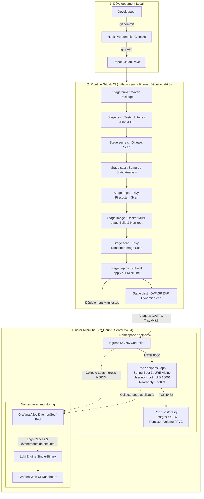

# SecureDesk — Architecture Globale DevSecOps & Déploiement Kubernetes

**Auteurs** : Oussama Hamada (CI/CD), Rayen Hassen (Kubernetes/DAST), Aladin Fadhli (Observabilité)  
**Contexte** : Pipeline automatisé GitLab CI, Déploiement Minikube local durci, Observabilité avec Loki/Alloy/Grafana  

---

## 1. Schéma d'Architecture Cible de Bout en Bout



---

## 2. Politiques des Barrières de Sécurité (Security Gates)

Chaque livraison logicielle doit traverser un ensemble de filtres rigoureux. Un échec sur un seuil critique interrompt immédiatement la livraison :

| Outil | Étape du Pipeline | Condition de Rupture (Exit Code != 0) | Justification Technique |
|:---|:---|:---|:---|
| **Gitleaks** | `secrets` | Détection d'un secret (regex/entropie) | Tout secret présent dans le git log est potentiellement compromis. |
| **Semgrep** | `sast` | Règle retournant une sévérité `ERROR` | Les injections (SQLi, XSS) doivent bloquer la chaîne avant packaging. |
| **Trivy (fs)** | `deps` | CVE `CRITICAL` avec correctif disponible | Interdiction d'embarquer des dépendances tierces vulnérables connues. |
| **Trivy (image)**| `scan` | CVE `CRITICAL` sur les packages de l'OS | L'image de base doit être minimale et exempte de failles critiques. |
| **OWASP ZAP** | `dast` | Alerte confirmée de niveau `HIGH` | Confirmation dynamique d'exploitabilité sur l'application déployée. |

---

## 3. Durcissement de l'Infrastructure Kubernetes

Le déploiement sous Minikube intègre les règles de durcissement recommandées par le benchmark CIS Kubernetes :

1. **Isolation par Namespaces** :
   - `helpdesk` pour l'application et la persistance.
   - `monitoring` pour la suite Alloy / Loki / Grafana.
2. **Politique Réseau (NetworkPolicy Zero-Trust)** :
   - Règle de refus par défaut (`default-deny-all`) dans le namespace `helpdesk`.
   - Seul le contrôleur Ingress NGINX est autorisé à contacter le port 8080 du pod `helpdesk-app`.
   - Seul le pod `helpdesk-app` est autorisé à communiquer avec le port 5432 du pod `postgresql`.
   - Le namespace `monitoring` peut uniquement scraper les métriques et lire les logs.
3. **Contexte de Sécurité des Pods (SecurityContext)** :
   ```yaml
   securityContext:
     runAsNonRoot: true
     runAsUser: 10001
     runAsGroup: 10001
     allowPrivilegeEscalation: false
     readOnlyRootFilesystem: true
     capabilities:
       drop:
         - ALL
   ```
4. **Gestion des Secrets et Volumes** :
   - Découplage strict via objets Kubernetes `Secret` et `ConfigMap`.
   - Stockage persistant PostgreSQL garanti par `PersistentVolumeClaim` (PVC) pour éviter toute perte de données lors des redémarrages.

---

## 4. Chaîne d'Observabilité et Détection des Attaques

- **Grafana Alloy** collecte les logs applicatifs (format JSON Spring Boot) et les logs d'accès HTTP Ingress NGINX.
- **Loki** indexe les flux avec les labels de pods, namespaces et codes HTTP.
- **Grafana Dashboards** permet la corrélation immédiate lors des tests DAST et des scénarios d'attaque :
  - Pics d'erreurs HTTP 401 / 403 (Tentatives de bypass de rôle V4 ou IDOR V3).
  - Requêtes contenant des patterns suspects SQL (`' OR '1'='1`) ou scripts XSS (`<script>`).
  - Détection d'appels répétés sur `/actuator/**`.

