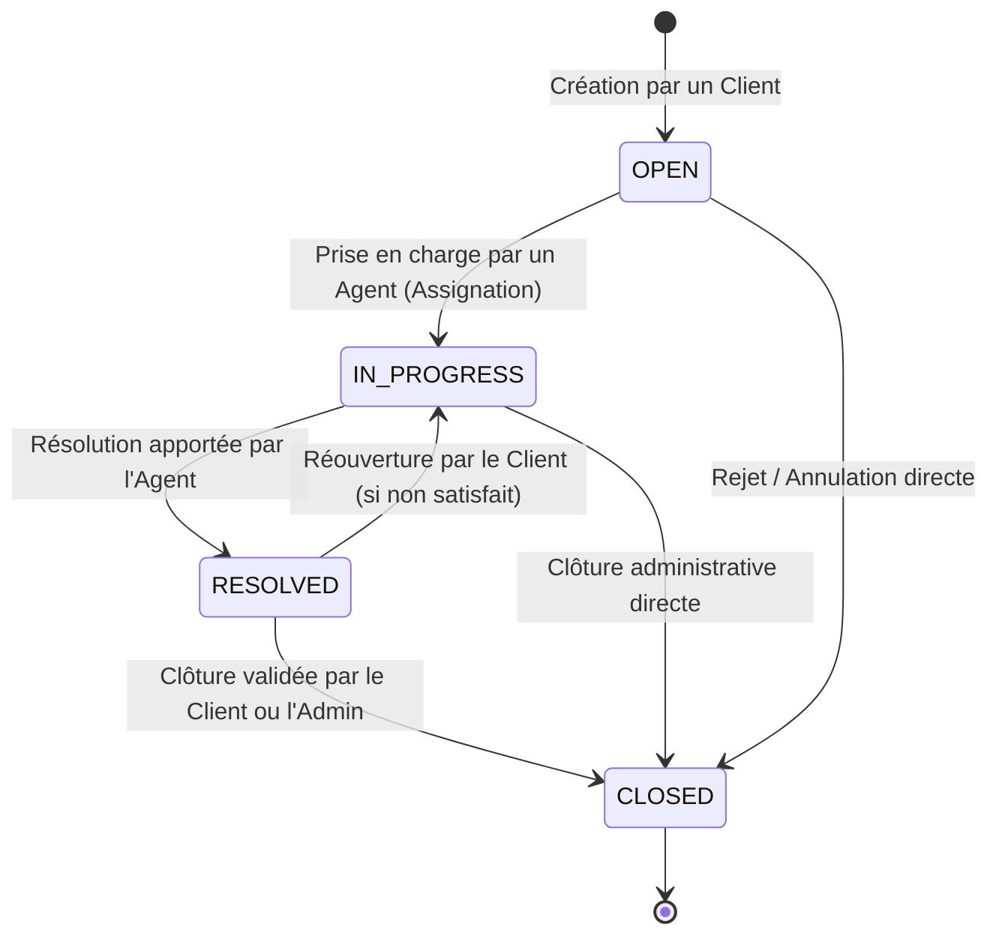
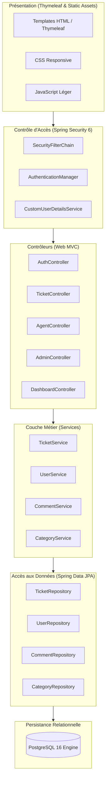
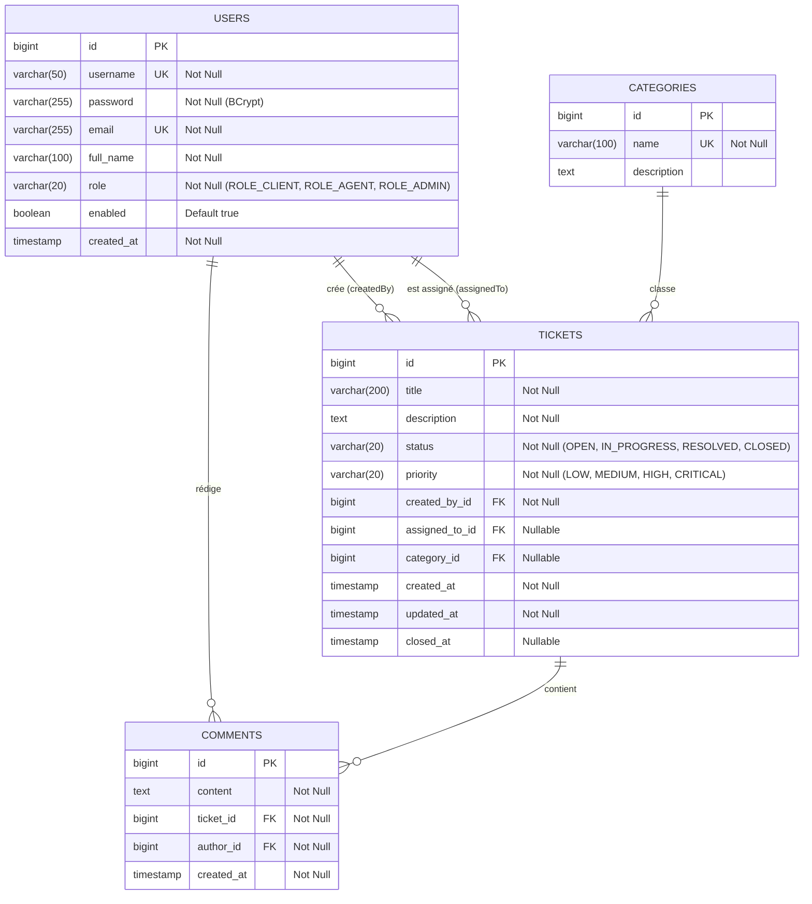

# SecureDesk — Spécifications Fonctionnelles et Techniques (Phase 1)

**Projet** : SecureDesk — HelpDesk d'Entreprise Sécurisé du Code à la Production  
**Équipe** : Rayen Hassen, Hamza Kalai, Oussama Hamada, Aladin Fadhli  
**Module** : DevSecOps · ING-5-SSIR-D (TEK-UP University)  
**Date** : Octobre 2026  
**Statut** : Validé  

---

## 1. Conception Fonctionnelle

### 1.1 Rôles et Matrice des Permissions (RBAC)

Le système SecureDesk articule ses fonctionnalités autour de trois rôles distincts définis dans l'énumération `Role` (`ROLE_CLIENT`, `ROLE_AGENT`, `ROLE_ADMIN`).

| Fonctionnalité | Client (`ROLE_CLIENT`) | Agent (`ROLE_AGENT`) | Administrateur (`ROLE_ADMIN`) |
|:---|:---:|:---:|:---:|
| **Authentification (Login/Logout)** | ✅ | ✅ | ✅ |
| **Inscription publique (`/register`)** | ✅ (crée un compte Client) | ❌ | ❌ |
| **Gestion du profil personnel (nom, password)** | ✅ | ✅ | ✅ |
| **Création d'un ticket** | ✅ | ❌ | ❌ |
| **Consultation de ses propres tickets** | ✅ | ✅ (si assigné) | ✅ (tous) |
| **Consultation des tickets d'autres clients** | ❌ (Strictement interdit) | ✅ (dans le scope support) | ✅ (tous) |
| **Recherche globale de tickets** | ❌ | ✅ | ✅ |
| **Modification du statut du ticket** | ❌ (sauf clôture optionnelle) | ✅ (`OPEN` ➔ `IN_PROGRESS` ➔ `RESOLVED`) | ✅ (tous statuts) |
| **Assignation d'un ticket à un agent** | ❌ | ✅ (auto-assignation / pool) | ✅ |
| **Ajout d'un commentaire** | ✅ (sur ses tickets uniquement) | ✅ | ✅ |
| **Gestion des utilisateurs (Créer, bloquer, rôles)** | ❌ | ❌ | ✅ |
| **Gestion des catégories de tickets** | ❌ | ❌ | ✅ |
| **Tableau de bord statistique global** | ❌ | ❌ | ✅ |
| **Accès aux endpoints `/admin/**`** | ❌ (Interdit / 403) | ❌ (Interdit / 403) | ✅ |

---

### 1.2 Cycle de Vie d'un Ticket

Le statut d'un ticket évolue selon une machine à états finis stricte définie par `TicketStatus` :

- **OPEN** : Ticket initialisé par le client. Visible dans la file d'attente générale des agents.
- **IN_PROGRESS** : Un agent s'est assigné le ticket et commence le diagnostic/traitement.
- **RESOLVED** : L'agent a apporté une solution ou une réponse concluante.
- **CLOSED** : Le ticket est archivé en lecture seule. Aucun commentaire supplémentaire n'est autorisé.

---

### 1.3 Règles Métier & Données Fictives

1. **Données Fictives** : Aucune donnée personnelle réelle (PII) ne doit être utilisée en conformité avec le RGPD et le cahier des charges académique. Les comptes pré-générés comprennent :
   - `admin` / `admin123` (Admin Système)
   - `agent` / `agent123` (Agent Support)
   - `client` / `client123` (Client Test)
2. **Isolement multi-locataire logique** : Un client ne doit sous aucun prétexte accéder aux métadonnées, tickets ou pièces jointes d'un autre client.
3. **Traçabilité** : Chaque modification (changement de statut, commentaire) conserve l'auteur et un horodatage immuable (`createdAt`, `updatedAt`).

---

## 2. Conception Technique

### 2.1 Architecture Logicielle (Spring Boot 3 / Layered Architecture)

L'application respecte les principes de conception découplée en couches (Layered Architecture) :

---

### 2.2 Modèle de Données Relationnel (PostgreSQL 16)

---

### 2.3 Matrice des Contrôleurs et Endpoints HTTP

| Méthode | URI | Rôle Requis | Description |
|:---|:---|:---|:---|
| `GET` | `/` | Public | Page d'accueil / redirection |
| `GET` | `/login` | Public | Formulaire d'authentification |
| `POST` | `/login` | Public | Traitement Spring Security |
| `GET` | `/register` | Public | Formulaire d'inscription |
| `POST` | `/register` | Public | Création compte Client |
| `GET` | `/dashboard` | Authentifié | Redirection contextuelle selon le rôle |
| `GET` | `/tickets` | Authentifié | Liste des tickets (filtrée selon le rôle) |
| `GET` | `/tickets/new` | `ROLE_CLIENT` | Formulaire de création de ticket |
| `POST` | `/tickets` | `ROLE_CLIENT` | Enregistrement d'un nouveau ticket |
| `GET` | `/tickets/{id}` | Authentifié | Détail du ticket + commentaires (Contrôle IDOR) |
| `POST` | `/tickets/{id}/comments` | Authentifié | Ajout d'un commentaire (Contrôle XSS) |
| `POST` | `/tickets/{id}/status` | `ROLE_AGENT`, `ROLE_ADMIN` | Changement de statut du ticket |
| `POST` | `/tickets/{id}/assign` | `ROLE_AGENT`, `ROLE_ADMIN` | Prise en charge ou réassignation |
| `GET` | `/agent/tickets` | `ROLE_AGENT`, `ROLE_ADMIN` | Console de traitement des agents |
| `GET` | `/agent/search` | `ROLE_AGENT`, `ROLE_ADMIN` | Recherche de tickets (Cible Injection SQL) |
| `GET` | `/admin/dashboard` | `ROLE_ADMIN` | Tableau de bord administratif |
| `GET` | `/admin/users` | `ROLE_ADMIN` | Gestion des comptes et rôles |
| `POST` | `/admin/users/{id}/role` | `ROLE_ADMIN` | Modification de privilèges |
| `GET` | `/admin/categories` | `ROLE_ADMIN` | Gestion des catégories |
| `GET` | `/actuator/**` | `ROLE_ADMIN` (durci) | Endpoints de métriques et santé Spring Boot |

---

### 2.4 Mécanisme d'Authentification et Sessions

- **Algorithme de hachage** : `BCryptPasswordEncoder` avec un facteur de coût de 10.
- **Gestion des sessions** : Session HTTP basée sur cookie `JSESSIONID` avec flags de sécurité :
  - `HttpOnly` (Protection contre l'exfiltration via XSS)
  - `SameSite=Lax` (Protection contre CSRF)
- **Protection CSRF** : Activée sur tous les formulaires d'état via tokens synchroniseurs Thymeleaf (`_csrf`).

